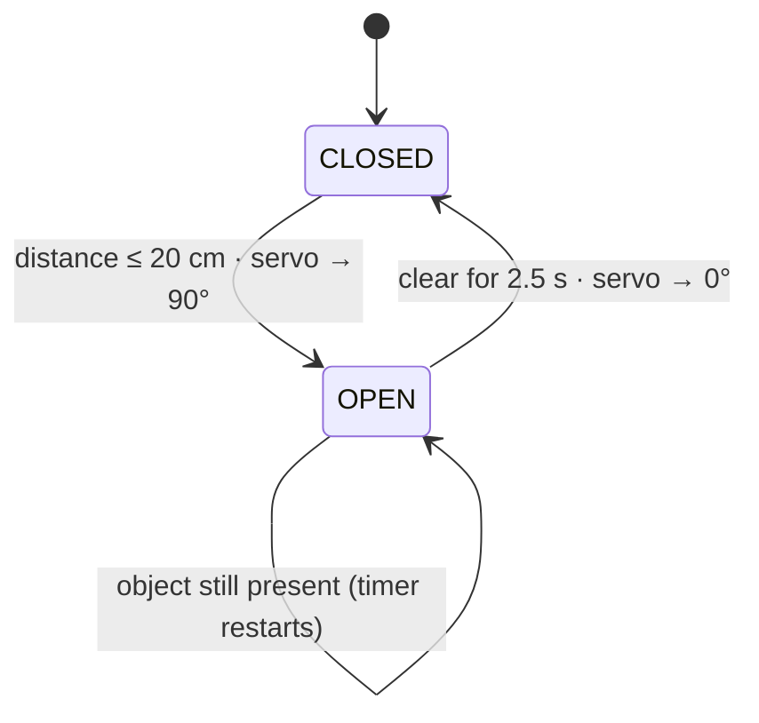

# 🗑️ Smart Automatic Trash Bin

> A touchless bin: an ultrasonic sensor measures distance, and when a hand comes within 20 cm a servo lifts the lid. It stays open while you're there and closes on its own when you leave.

---

## Contents
1. [Project Overview](#1-project-overview) · 2. [Objective](#2-objective) · 3. [Components](#3-components) · 4. [Working Principle](#4-working-principle) · 5. [Circuit Design](#5-circuit-design) · 6. [Implementation](#6-implementation) · 7. [Source Code](#7-source-code) · 8. [Results](#8-results) · 9. [Challenges](#9-challenges) · 10. [Future Improvements](#10-future-improvements)

---

## 1. Project Overview

A full embedded system in a small package: a **sensor** that measures the world, **firmware** that decides, and an **actuator** that does something physical. The prototype enclosure was built from cardboard to show the mechanism working.

## 2. Objective

- Measure distance without contact using time-of-flight.
- Control a servo position from a microcontroller.
- Combine electronics and a mechanical linkage.
- Structure firmware as a **state machine**, not a chain of delays.

## 3. Components

| Component | Role | Why |
|---|---|---|
| Arduino Uno | Controller | Reconstructed implementation |
| HC-SR04 ultrasonic sensor | Distance measurement | Measures 2–400 cm and isn't affected by object colour (an IR proximity sensor is) |
| SG90-class servo | Lid actuator | Position control built in, so no extra driver is needed |
| Separate 5 V supply + 470 µF capacitor | Servo power | A servo's start-up current spike can brown out the Arduino if they share its 5 V pin |
| Cardboard | Prototype enclosure and lid | Quick and cheap to build |

> **Reconstruction note:** Controller used in the reconstructed implementation: Arduino Uno. The HC-SR04 is an assumed replacement; the original proximity sensor wasn't confirmed.

## 4. Working Principle

### 4.1 Ultrasonic time-of-flight

1. A 10 µs pulse on **TRIG** makes the module send a burst of 8 × 40 kHz ultrasonic cycles.
2. **ECHO** goes HIGH and stays high until the reflection comes back.
3. The pulse width is the round-trip time, so:

$$d = \frac{t_{echo} \times v_{sound}}{2} = t_{echo}[\mu s] \times \frac{0.0343\ \text{cm}/\mu s}{2}$$

Example: a 1166 µs echo means 1166 × 0.01715 ≈ **20 cm**, exactly the trigger threshold.

### 4.2 Lid state machine

The lid **doesn't** close on a fixed timer. It closes 2.5 s after the hand *leaves*, so it never comes down on someone who's still using it.

### 4.3 Servo control

A hobby servo reads a 50 Hz pulse train: a ~1 ms pulse means 0° and ~2 ms means 180°. The `Servo` library generates this in the background, so the main loop is free.

## 5. Circuit Design

| Component | Pin | Note |
|---|---|---|
| HC-SR04 VCC / GND | 5 V / GND | |
| HC-SR04 TRIG | D7 | |
| HC-SR04 ECHO | D8 | 5 V output, which is fine for the Uno (5 V logic) |
| Servo signal | D9 | |
| Servo V+ / GND | external 5 V / GND | 470 µF across the servo supply |
| External GND | Arduino GND | common ground |

## 6. Implementation

1. Test the HC-SR04 alone and check the Serial distances against a ruler.
2. Test the servo alone at 0° and 90°, and check the lid linkage reaches both positions without binding.
3. Mount the sensor on the front of the bin, angled slightly up so it doesn't see the floor.
4. Combine both and tune `DETECTION_DISTANCE_CM` and `HOLD_OPEN_MS`.

## 7. Source Code

📄 [`Code/smart_trash_bin/smart_trash_bin.ino`](Code/smart_trash_bin/smart_trash_bin.ino)

| Design choice | Reason |
|---|---|
| `millis()`-based loop, no long `delay()` | The sensor keeps measuring while the lid is open, so the firmware can tell whether the hand is still there |
| Median of 3 readings | One stray echo can't open the lid on its own |
| `pulseIn(..., 30000)` timeout | Without a timeout, a missing echo would block for 1 s |
| 60 ms between measurements | Lets the previous ping's echoes die out (HC-SR04 recommendation) |
| CSV Serial output | Distance and lid state can be logged and plotted |

## 8. Results

- The lid opens when a hand comes within ~20 cm and closes automatically after the area is clear.
- The cardboard prototype shows the complete sense → decide → actuate loop working.

## 9. Challenges

- **Servo brown-outs.** A servo drawing current from the Arduino's 5 V pin can reset the board when it starts moving. Powering it separately, with a bulk capacitor, fixes this.
- **Cardboard mechanics.** Cardboard bends under the servo's torque, so the lid's open angle isn't consistent. A rigid lever arm helps.
- **Soft and angled surfaces.** Fabric or angled hands can scatter the ultrasonic pulse, so readings drop out. The median filter smooths over single failures.

## 10. Future Improvements

- [ ] A second sensor inside the lid to detect when the bin is **full**.
- [ ] Battery operation with sleep mode between measurements.
- [ ] Slow the servo's movement for a quieter, smoother lid.
- [ ] Plot **distance vs time** and **lid state vs time** from the CSV log.
- [ ] Measure the detection-to-open response time.

## References

See [`References/`](References/).
